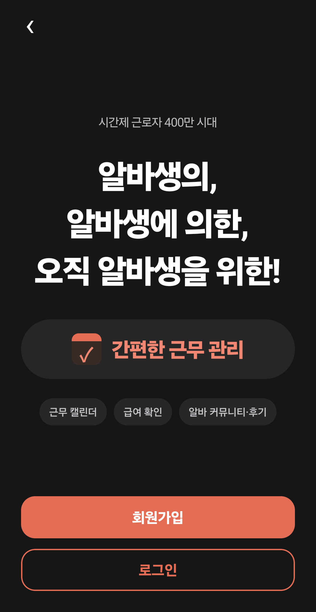
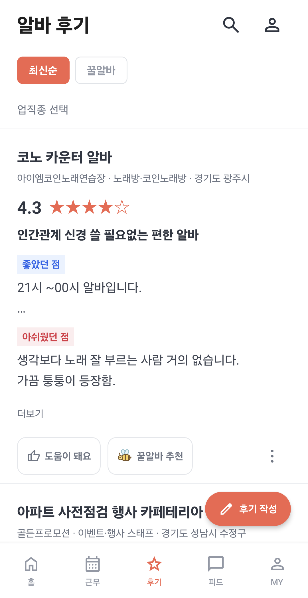
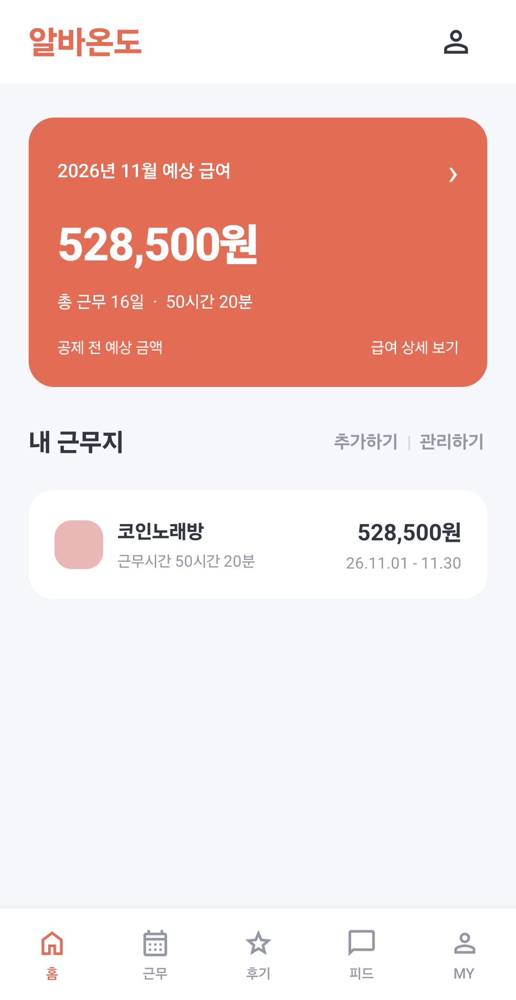
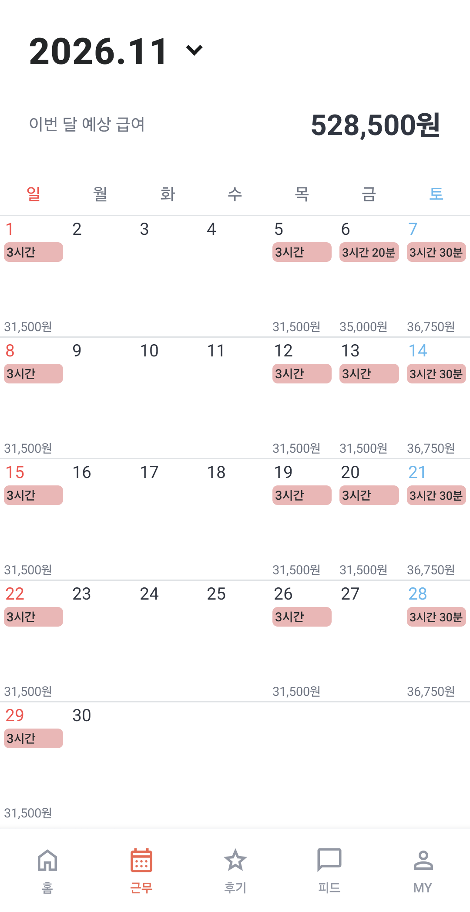

# 알바온도

**알바온도는 아르바이트 근로자를 위한 애플리케이션입니다.** 근무 일정과 급여를 관리하고, 근무 후기로 일터를 비교하고, 커뮤니티에서 다른 근로자와 경험을 나눌 수 있습니다.

[구글 플레이 바로가기](https://play.google.com/store/apps/details?id=com.albaondo.app)

| 시작 화면 | 알바 후기 | 월 예상 급여 | 근무 캘린더 |
| :---: | :---: | :---: | :---: |
|  |  |  |  |

이 저장소는 운영 백엔드에서 후기와 인증 흐름을 추려낸 Java 포트폴리오입니다. 제목·본문·근무 연도만으로 후기 등록 재시도, 작성자 권한 검사, 토큰 재발급을 테스트할 수 있습니다.

---

## 기술 스택

| 구분 | 기술 |
| --- | --- |
| Backend |       |
| Security |   |
| Database |  |
| Mobile |   |
| Web |   |
| Test |     |

운영 앱과 웹은 Spring 백엔드와 MySQL을 사용합니다. 공개 저장소에서는 H2로 후기 API를 테스트합니다.
