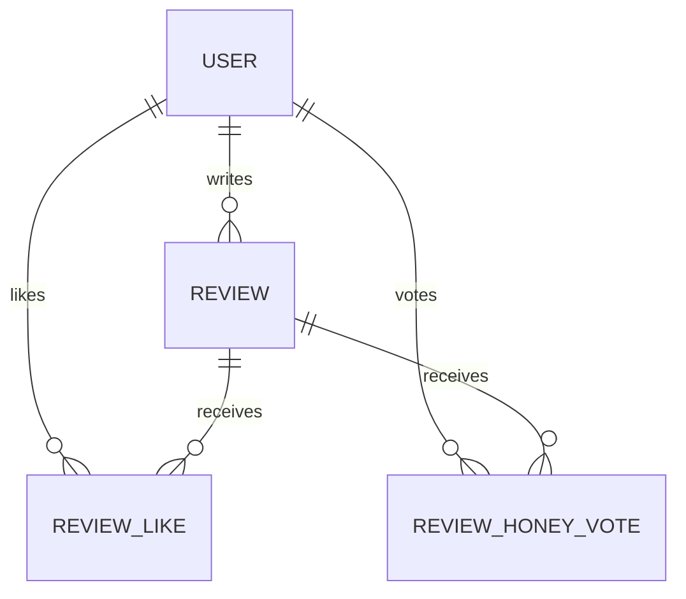

# 알바온도

**아르바이트를 구하는 사람이 근무지 후기를 찾아보고, 직접 일한 사람이 근무 경험과 평가를 남기는 서비스입니다.** [Google Play에서 알바온도 보기](https://play.google.com/store/apps/details?id=com.albaondo.app)

출시 앱에서는 브랜드·지역 등 근무 정보를 담아 후기를 작성하고, 키워드와 업종으로 다른 사람의 후기를 찾을 수 있습니다. 이 저장소는 운영 백엔드에서 후기와 인증 흐름을 추려낸 Java 포트폴리오입니다. 제목·본문·근무 연도만으로 후기 등록 재시도, 작성자 권한 검사, 토큰 재발급을 테스트할 수 있습니다.

---

## 기술 스택

| 구분 | 기술 |
| --- | --- |
| Backend |       |
| Security |   |
| Database |  |
| Mobile |   |
| Web |   |
| Test |     |

운영 앱과 웹은 Spring 백엔드와 MySQL을 사용합니다. 공개 저장소에서는 H2로 후기 API를 테스트합니다.

---

## 출시 앱의 대표 화면과 이용 흐름

| 화면 | 이용자가 하는 일 |
| --- | --- |
| 후기 탐색 | 키워드와 업종을 선택해 후기를 좁히고 최신순·인기순으로 살펴봅니다. 인기순은 좋아요 수가 같은 경우 작성 시각, 후기 ID 순으로 정렬합니다. |
| 후기 작성 | 브랜드와 지역 등 근무 정보를 입력하고 경험을 기록합니다. 작성자는 등록한 후기를 수정하거나 숨길 수 있습니다. |
| 후기 상세 | 근무 경험과 평가를 읽고 좋아요를 누르거나 나중에 다시 볼 후기를 북마크합니다. |

## 후기 도메인 ERD

공개 코드의 네 엔티티를 기준으로 표시했습니다. 좋아요와 꿀알바 투표는 각각 어느 회원이 어느 후기에 반응했는지 기록합니다.



## 핵심 설계와 문제 해결

### 1. 후기 등록 응답이 유실돼도 한 번만 저장

저장은 끝났지만 모바일 앱이 응답을 받지 못하면 같은 후기를 다시 제출할 수 있습니다. 앱은 한 번의 제출에 UUID 하나를 부여하고, 재시도할 때 같은 `Idempotency-Key`를 보냅니다.

서버는 트랜잭션 안에서 작성자 행을 먼저 잠근 뒤 해당 회원의 요청 키를 조회합니다. 같은 회원의 동시 등록은 이 행에서 대기합니다. 첫 요청이면 후기와 최초 입력의 해시를 함께 저장하고, DB에서도 작성자·요청 키 조합에 유일 제약을 둡니다.

| 재요청 조건 | 공개 API의 결과 |
| --- | --- |
| 같은 회원·키·최초 입력 | 추가 저장 없이 최초와 같은 `201 Created` |
| 같은 회원·키, 다른 입력 | `409 IDEMPOTENCY_CONFLICT` |
| 키 누락 또는 UUID 형식 오류 | `400 Bad Request` |

수정·삭제 후에도 최초 해시를 보존하므로 뒤늦은 재전송이 수정 내용을 덮어쓰거나 숨긴 후기를 복원하지 않습니다. [후기 서비스](src/main/java/com/example/albaondo_public/review/service/ReviewService.java) · [후기 엔티티](src/main/java/com/example/albaondo_public/review/domain/Review.java)

### 2. 후기 수정·삭제에서 작성자와 상태 확인

컨트롤러는 인증된 회원 ID를 서비스에 전달합니다. 서비스는 회원 → 후기 순서로 행을 잠그고 작성자 ID가 일치하는지 확인합니다. 삭제하면 후기는 `HIDDEN` 상태로 남습니다. 작성자가 삭제를 반복해도 성공하며 숨긴 후기를 수정하면 거절합니다. 전체 목록과 내 목록 모두 저장소 조회 단계에서 `PUBLISHED` 조건을 적용합니다. [후기 컨트롤러](src/main/java/com/example/albaondo_public/review/controller/ReviewController.java) · [후기 저장소](src/main/java/com/example/albaondo_public/review/repository/ReviewRepository.java)

### 3. JWT 발급 이후 바뀐 계정 상태 반영

토큰 유효기간 중에도 회원 상태나 역할이 바뀔 수 있습니다. 요청 필터는 액세스 토큰의 서명·용도·만료를 검사한 뒤 회원을 조회합니다. 회원 상태·역할·토큰 버전 검사를 통과하면 현재 DB 역할로 인증 정보를 구성합니다. 검증에 실패하면 인증 컨텍스트를 비우고 요청 처리를 종료합니다. [JwtAuthenticationFilter](src/main/java/com/example/albaondo_public/global/filter/JwtAuthenticationFilter.java) · [JwtProvider](src/main/java/com/example/albaondo_public/global/security/JwtProvider.java)

## 공개 코드의 주요 API

후기 API는 활성 회원의 액세스 토큰을 요구합니다. 여기서 ‘공개 후기’는 다른 로그인 회원도 읽을 수 있는 후기를 뜻합니다.

| 메서드 | 경로 | 동작 |
| --- | --- | --- |
| POST | `/api/reviews` | 후기 작성 성공 시 본문 없이 `201 Created` 반환 |
| GET | `/api/reviews` | 공개 후기 목록 조회 |
| GET | `/api/reviews/mine` | 로그인한 회원이 작성한 공개 후기 목록 조회 |
| PUT | `/api/reviews/{reviewId}` | 작성자가 제목·본문·근무 연도를 수정 |
| DELETE | `/api/reviews/{reviewId}` | 작성자가 후기를 숨김 처리 |
| POST | `/api/auth/refresh` | 리프레시 토큰으로 액세스 토큰 재발급 |

두 목록은 모두 후기 ID 내림차순으로 정렬합니다. `page`는 0부터 시작하고 `size`는 기본 20, 최대 50입니다. 클라이언트는 각 항목의 제목·본문·근무 연도 전체를 펼쳐 볼 수 있습니다. `mine`은 로그인한 회원의 후기인지 표시하고, `hasNext`는 다음 페이지가 있는지 알려줍니다.

```json
{
  "items": [
    {
      "reviewId": 42,
      "title": "카페 주말 근무 후기",
      "content": "오픈 준비와 주문 응대를 맡았습니다.",
      "workYear": 2025,
      "likeCount": 0,
      "mine": true
    }
  ],
  "page": 0,
  "size": 20,
  "hasNext": false
}
```

## 인증 설정과 재발급

Spring은 시작할 때 `jwt.secret-key` 값을 외부 설정에서 읽어 `JwtProvider`를 생성하고 인증 필터에 전달합니다. 필터가 읽을 헤더 이름은 `jwt.access-header`로 설정하며 기본값은 `Authorization`입니다. [빈 생성과 필터 등록](src/main/java/com/example/albaondo_public/global/config/SecurityConfig.java)

로그인 성공 후 서버가 호출하는 `JwtProvider.issueTokens(user)`는 인증된 회원의 ID, 역할, 토큰 버전을 담은 액세스·리프레시 토큰을 발급합니다. 공개본은 이 발급 메서드부터 시작하며, 로그인 화면과 자격 증명 검증은 원본 서비스에서 담당합니다.

| 설정 | 공개본 기본값 | 용도 |
| --- | --- | --- |
| `jwt.access.expiration` | `PT15M` (15분) | 후기 API용 액세스 토큰 유효기간 |
| `jwt.refresh.expiration` | `P14D` (14일) | 액세스 토큰 재발급 가능 기간 |
| `jwt.refresh.header` | `X-Refresh-Token` | 재발급 요청에서 읽을 헤더 |

액세스 토큰이 만료되면 `POST /api/auth/refresh`에 `X-Refresh-Token: Bearer <refreshToken>` 헤더만 보냅니다. 서버는 서명·용도·만료 시각과 현재 회원 상태·역할·토큰 버전을 확인하고 `{"accessToken":"..."}`을 반환합니다. 기존 리프레시 토큰은 최초 만료 시각까지 재사용하며, 회원의 토큰 버전이 바뀌면 즉시 거절합니다. 리프레시 토큰까지 만료되면 다시 로그인해야 합니다.

## 로컬에서 확인하기

JDK 21에서 `./gradlew test`를 실행합니다. Windows에서는 `.\gradlew.bat test`를 사용합니다. 외부 계정이나 운영 DB 연결 없이 검증할 수 있습니다.

- [후기 API 테스트](src/test/java/com/example/albaondo_public/ReviewApiTest.java)는 인증된 사용자를 설정한 뒤 MockMvc와 H2로 저장부터 응답까지 확인합니다. 두 회원의 전체·내 목록이 어떻게 달라지는지, 다른 회원의 수정·삭제가 거절되는지, 삭제된 후기가 두 목록에서 사라지는지를 볼 수 있습니다.
- [후기 반응 도메인 테스트](src/test/java/com/example/albaondo_public/ReviewReactionTest.java)는 작성자와 요청자가 서로 다른 자바 객체여도 회원 ID가 같으면 두 반응을 모두 거절하는지 확인합니다.
